# LearnDX12：DirectX 12 实时渲染器

从零用 DirectX 12 写的实时渲染器。先跟着 Frank Luna《DirectX 12 3D 游戏开发实战》逐章实现，
再在上面加了**延迟渲染、64 盏点光源（光体积）、SSAO、PBR + IBL、HDR + Bloom**，以及着色器热重载和 GPU 分 Pass 计时。

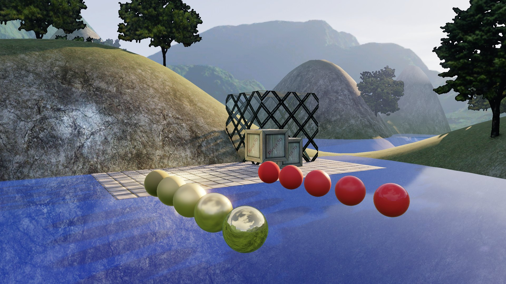

<sub>预设机位 1「开场全景」，2560×1440。RTX 5060 Laptop 上整帧 GPU 约 1.9 ms（Release，见[帧流程与耗时](#帧流程与耗时)）。</sub>

## 功能

**渲染**

- **延迟渲染**：两张 G-Buffer（MRT）+ 可当纹理读的深度，全屏光照 Pass 从深度还原世界坐标；可以随时切回前向渲染对比
- **64 盏点光源**，三种画法可切换：前向逐像素循环 / 延迟全屏循环 / 光体积（每盏灯画一个球，剔除正面 + 加法混合）
- **SSAO**：世界空间，半分辨率 R8，14 个采样方向 × 每像素随机旋转；双边模糊（法线 + 深度判断是不是同一表面）；只乘到环境光上
- **PBR 直接光**：金属度 / 粗糙度工作流，GGX 法线分布 + 高度相关 Smith 可见性 + Schlick 菲涅尔
- **IBL（基于图像的光照）**：启动时用计算着色器从天空图生成辐照度图、预滤波环境贴图（5 级 mip 对应 5 档粗糙度，GGX 重要性采样）和 BRDF LUT（split-sum），替换原来的常数环境光；前向和延迟共用
- **HDR + Bloom**：R16G16B16A16_FLOAT 场景缓冲，6 级降采样 / 升采样 Bloom，四种色调曲线（截断 / Reinhard / ACES / AgX）+ 曝光
- **阴影贴图**：4096²，比较采样器做 PCF
- 法线贴图、立方体贴图天空、雾、模板缓冲做的镜子、半透明波浪水面、几何着色器公告牌树、alpha 测试铁丝网
- 计算着色器后期模糊（横、竖两趟，每个线程组处理一行 / 一列里的 256 个像素）

**工程**

- Agility SDK 1.619 + DXC 编译，Shader Model 6.6
- **着色器热重载**：保存任意 `.hlsl`，0.25 秒内自动重编、重建 PSO；编译失败时弹出 DXC 报错，继续用旧 PSO
- **GPU 时间戳**：每个 Pass 单独计时，60 帧取平均，显示在窗口标题
- Dear ImGui 调试面板（中文字体，跟着 DPI 缩放）：开关各个效果、切 G-Buffer 视图、调曝光 / Bloom / 太阳方向、选预设机位
- 2K 窗口 + Per-Monitor DPI 感知，自动选高性能独显，关垂直同步时用 `ALLOW_TEARING`

## 画面

| | |
|---|---|
| 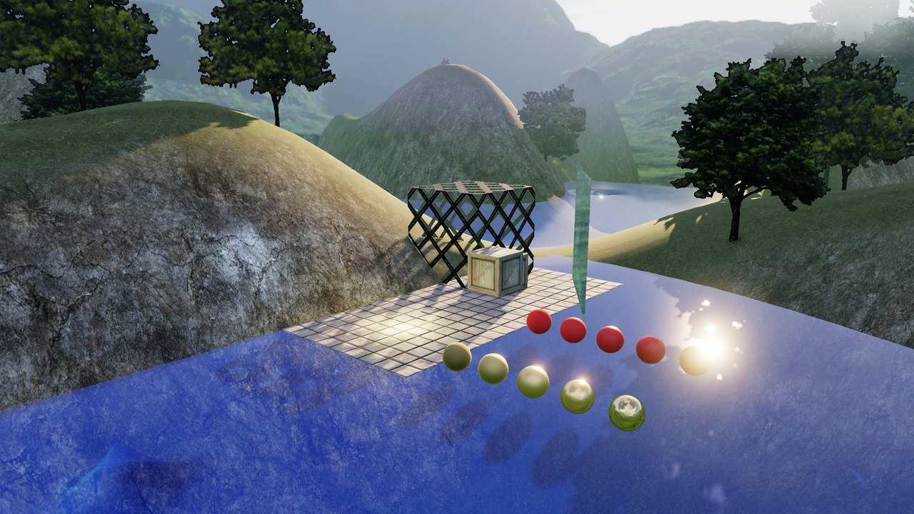 | 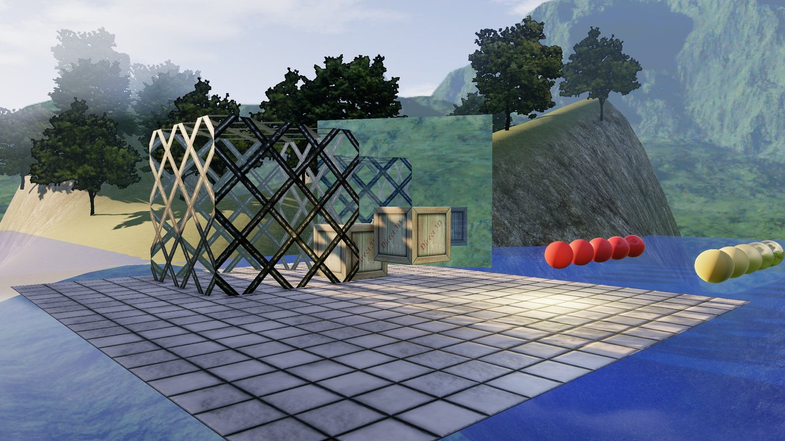 |
| **水面与倒影**：半透明波浪水面、太阳高光 + Bloom | **铁丝网、镜子和木箱**：alpha 测试、模板缓冲镜子、阴影 |
| 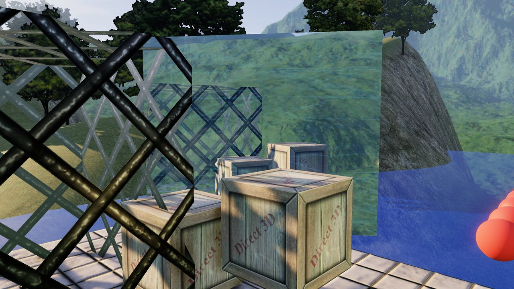 | 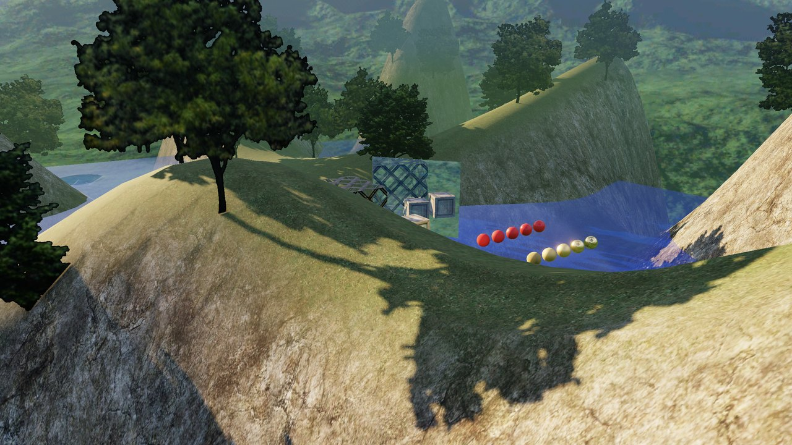 |
| **镜子特写**：镜子里的场景重新画一遍（反射矩阵 + 模板） | **山坡、树影和雾**：公告牌树投下的阴影、远处的雾 |
| 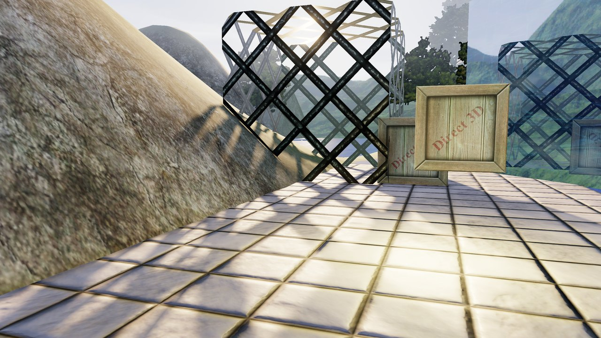 | 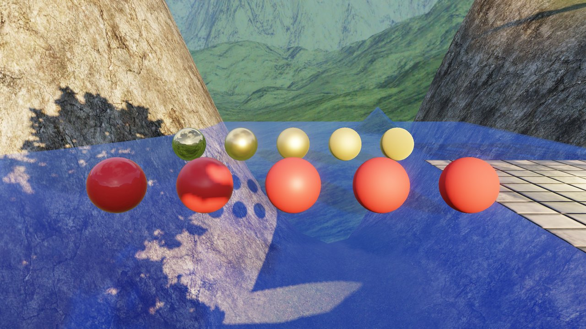 |
| **法线贴图地板**：砖缝凹凸来自法线贴图 | **PBR 测试球**：一排从光滑到粗糙，金属 / 非金属各一排 |

## 延迟渲染与 G-Buffer

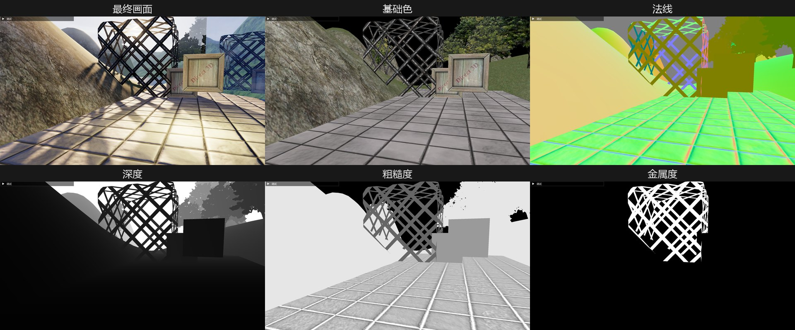

| 渲染目标 | 格式 | 内容 |
|---|---|---|
| G-Buffer 0 | `R8G8B8A8_UNORM_SRGB` | RGB 基础色，A 金属度 |
| G-Buffer 1 | `R16G16B16A16_FLOAT` | XYZ 世界空间法线，W 粗糙度 |
| 深度 | `R24G8_TYPELESS` | 写入时当 DSV（`D24_UNORM_S8_UINT`），光照时当 SRV 读（`R24_UNORM_X8_TYPELESS`） |

每个像素 12 字节 G-Buffer + 4 字节深度。光照 Pass 用深度和逆 ViewProj 矩阵还原世界坐标，不单独存位置。
面板里的"G-Buffer 视图"可以逐个查看基础色、法线、粗糙度、金属度、深度、世界坐标和环境光遮蔽。

### 64 盏小灯

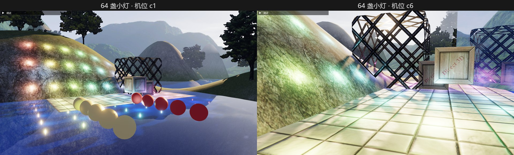

小灯的数量是编译着色器时传的宏，勾选后会热重编。三种画法的耗时（2K，"不透明 / G-Buffer"和"光照"两段之和）：

| 机位 | 前向循环 | 延迟全屏循环 | 光体积 |
|---|---|---|---|
| c1（灯散在山坡和水面上） | 1.11 ms | 0.97 ms | **0.75 ms** |
| c6（贴近地面，灯球互相重叠） | 1.87 ms | **1.15 ms** | 1.54 ms |

<sub>Debug 构建测的（着色器没开优化），绝对值偏大，看相对快慢。</sub>

灯分散时光体积最快，只算球覆盖到的像素；镜头贴近、很多灯球叠在同一块屏幕上时，每层球都要再读一遍 G-Buffer，
反而比全屏循环慢。这正是分块（Tiled）/ 分簇（Clustered）光照要解决的问题。

## SSAO

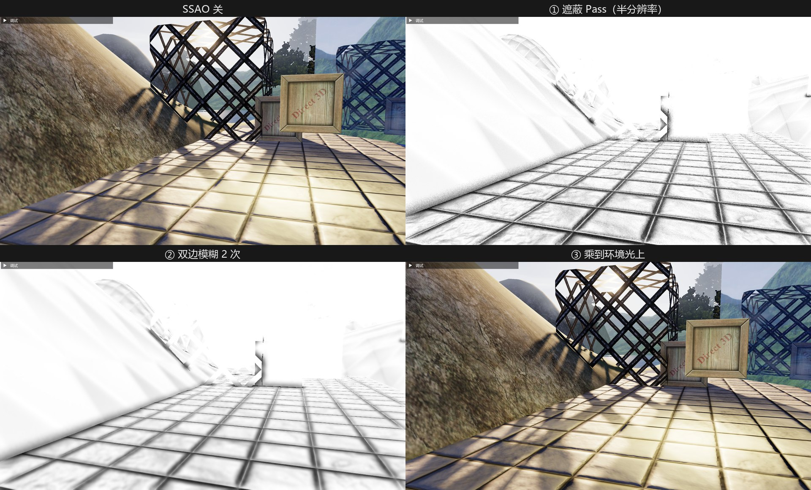

1. **遮蔽 Pass**：半分辨率。每个像素在法线一侧的半球里取 14 个点，投影回屏幕，读出那里真正的表面点，
   看它是不是挡在法线前方、离得够不够近；每个像素用哈希出的随机向量把采样方向打乱，采样少也不会出现规则的条纹
2. **双边模糊**：横、竖各一趟算一次，两张遮蔽图来回倒。邻居的法线夹角太大或深度差太多就不参与，边缘不会被糊开
3. **合成**：遮蔽图双线性放大，只乘到环境光上，直接光不受影响

## IBL：基于图像的光照

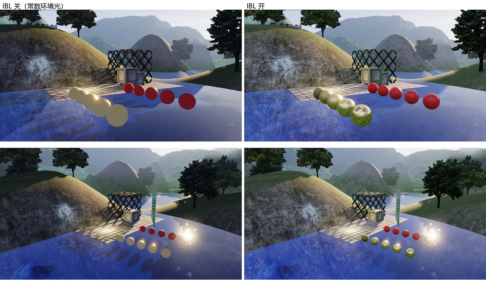

天空不只是背景，它从四面八方照亮场景。原来的环境光是一个常数，不管表面朝哪都一样；
IBL 改成从天空图里取光：朝上的面拿到的是天空的蓝白色，朝下的面拿到的是地面的绿色，金属能照出周围的环境。
每个像素当场对整个半球积分太贵，所以启动后第一帧用三个计算着色器（`HLSL/IBL.hlsl`）把要用的积分先算好，之后每帧只查表：

| 预计算的图 | 大小 / 格式 | 存什么 | 怎么查 |
|---|---|---|---|
| 辐照度图 | 32² × 6 面，`R16G16B16A16_FLOAT` | 法线朝这个方向时，半球上的天空按 cosθ 加权平均 | 用法线 |
| 预滤波环境贴图 | 256² × 6 面，5 级 mip | 第 i 级 = 按粗糙度 i/4 用 GGX 糊过的天空（每个像素 1024 个重要性采样） | 用反射方向，mip 级 = 粗糙度 × 4 |
| BRDF LUT | 256²，`R16G16_FLOAT` | 镜面积分里只和 (NoV, 粗糙度) 有关的那一半，拆成 A、B 两个数 | 用 (NoV, 粗糙度) |

```
环境光 = 漫反射颜色 × 辐照度图(n) + 预滤波环境贴图(R, 粗糙度) × (F0·A + B)
```

镜面这一项就是 split-sum 近似（UE4 的做法）：把"天空 × BRDF"的积分拆成"按 GGX 糊过的天空"和"BRDF 自己的积分"两个积分相乘。
SSAO 照旧只乘在这个环境光上。

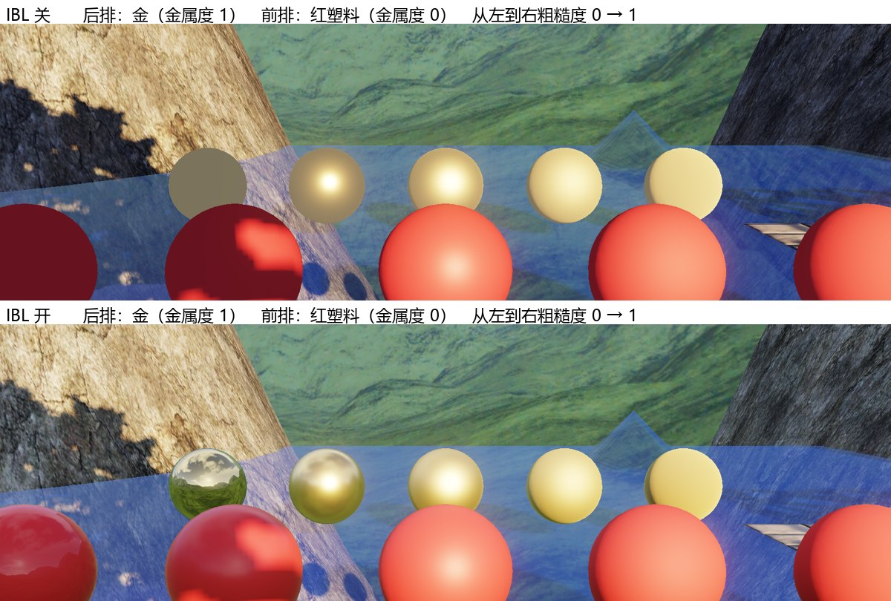

- **耗时**：三张图生成一次约 7.3 ms，只在启动后第一帧和着色器热重载之后跑；每帧光照 Pass 多 3 次纹理采样，2K 下多约 0.04 ms（Release，7 个预设机位平均：0.32 → 0.36 ms）
- **调试**：面板里可以开关 IBL、调强度、把天空换成辐照度图或预滤波的任意一级查看；BRDF LUT 直接显示在面板上；预计算的 GPU 耗时用单独的时间戳显示
- **验证**：RenderDoc 抓帧读出 LUT 的值，和用 Python 独立积分的结果一致（误差 ≤ 0.0004）；辐照度图和 Python 的结果相差 2% 以内
- **局限**：天空图被当成无限远，照不出场景里近处的东西（金球照出的是天空图里的草地，不是脚下的水）；需要反射探针或屏幕空间反射来补

## HDR 与色调映射

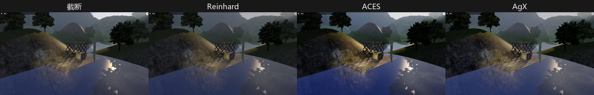

场景先画到 16 位浮点缓冲里，亮度可以远超 1（调高太阳强度时，水面高光能到 5.8）。
Bloom 从亮部提取后逐级降采样再升采样叠回去，最后按曝光值和所选曲线映射回屏幕。
上图是同一曝光下的四种曲线：截断把高光切成一片死白，Reinhard 整体发灰，ACES 对比强，AgX 高光往白色走、不偏色。

## 帧流程与耗时

每帧依次执行下面这些 Pass，耗时用 GPU 时间戳量：
Release 构建，关垂直同步，延迟渲染 + SSAO + IBL + Bloom，7 个预设机位的平均，RTX 5060 Laptop。

| Pass | 2560×1440 | 1280×720 |
|---|---|---|
| 阴影图（4096²） | 0.07 ms | 0.06 ms |
| 不透明 / G-Buffer | 0.20 ms | 0.06 ms |
| SSAO（遮蔽 + 横竖模糊 2 次） | 0.91 ms | 0.23 ms |
| 光照（全屏，含 IBL 环境光） | 0.36 ms | 0.06 ms |
| 天空 + 镜子 | 0.07 ms | 0.01 ms |
| 透明（水面） | 0.09 ms | 0.02 ms |
| Bloom | 0.13 ms | 0.04 ms |
| 色调映射 | 0.06 ms | 0.01 ms |
| **整帧** | **1.88 ms** | **0.50 ms** |

<sub>不含 IBL 预计算（约 7.3 ms，只在启动后第一帧和热重载后跑一次）。关掉 IBL 时 2K 整帧 1.82 ms。</sub>

## 操作

| 输入 | 作用 |
|---|---|
| W / A / S / D | 前后左右移动 |
| Q / E | 下降 / 上升 |
| 鼠标左键拖动 | 旋转视角 |
| 鼠标右键拖动 | 拉近 / 拉远 |
| 滚轮 | 调移动速度（每格 ×1.25） |
| B | 开关后期模糊 |
| 调试面板 | 预设机位、各效果开关和参数 |
| Esc | 退出 |

## 编译运行

- Windows 10 / 11，支持 Shader Model 6.6 的显卡
- Visual Studio 2022（MSVC v143），C++20，x64；打开 `LearnDX12.sln` 编译运行
- **Windows SDK 10.0.26100.0**：编译后会从 SDK 的 `bin\10.0.26100.0\x64` 复制 `dxcompiler.dll`、`dxil.dll`
- **Agility SDK 1.619.6**：工程里写的路径是 `D:\DX12\Env\AgilitySDK\1.619.6\build\native`，
  放在别处要改 `LearnDX12.vcxproj` 里的附加包含目录和生成后事件（Debug、Release 各一处）
- 运行时从工作目录读 `HLSL\` 和 `Textures\`，在 VS 里直接运行即可

## 目录

| 路径 | 内容 |
|---|---|
| `main.cpp` | 整个渲染器：资源、根签名、PSO、每一帧的各个 Pass、调试面板 |
| `Common/` | 应用框架（窗口、设备、交换链）、摄像机、计时器、DXC 编译、DDS 加载、几何体生成 |
| `HLSL/` | 着色器：前向 / G-Buffer（`Triangle.hlsl`）、延迟光照 + SSAO（`Deferred.hlsl`）、IBL 预计算（`IBL.hlsl`）、Bloom、色调映射、天空、模糊、公告牌树 |
| `FrameResource.*` | 每帧的常量缓冲（CPU 最多领先 GPU 3 帧） |
| `Waves.*` | 波浪水面 |
| `Textures/` | 贴图（来自书的配套示例） |
| `ThirdParty/imgui` | Dear ImGui |

## 参考与说明

- Frank Luna，《DirectX 12 3D 游戏开发实战》：框架和第 1–13、15、18–20 章的基础功能照书实现；贴图来自书的配套示例
- Brian Karis，*Real Shading in Unreal Engine 4*（SIGGRAPH 2013 课程）：IBL 的 split-sum 近似和预滤波环境贴图
- [Dear ImGui](https://github.com/ocornut/imgui)（MIT）
- 用这个渲染器导出数据做的超分小项目：[NeuralSR](https://github.com/advance-cmd/NeuralSR)
- 渲染相关的代码（管线、着色器、资源与同步）是我自己写的；窗口 / UI 外围、测试脚本和部分重构有 AI（Claude）协助，提交记录里的 Co-Authored-By 就是这部分
